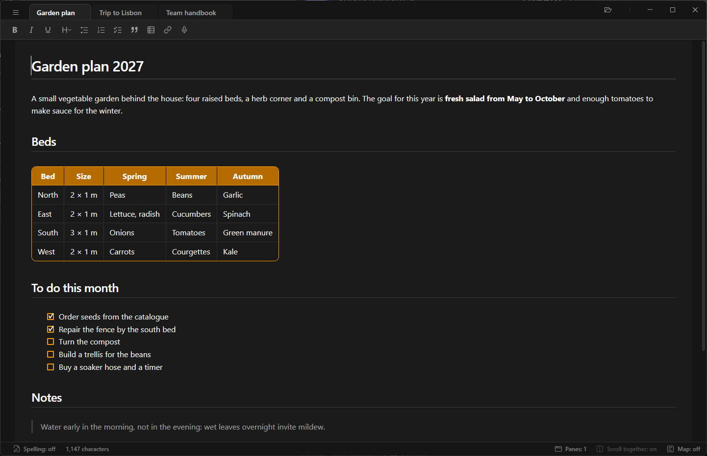
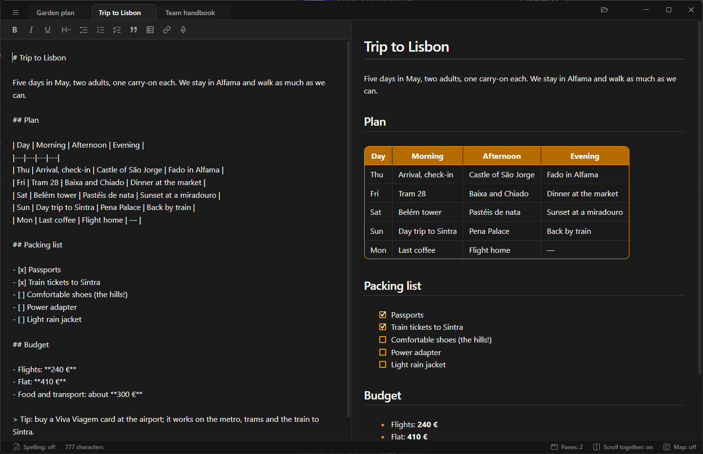
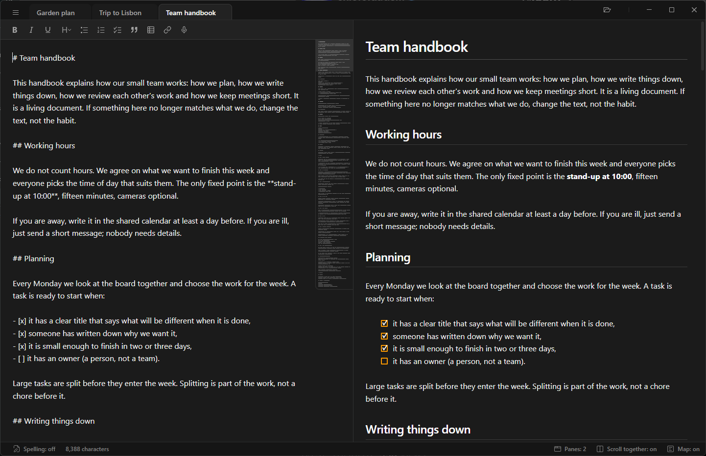
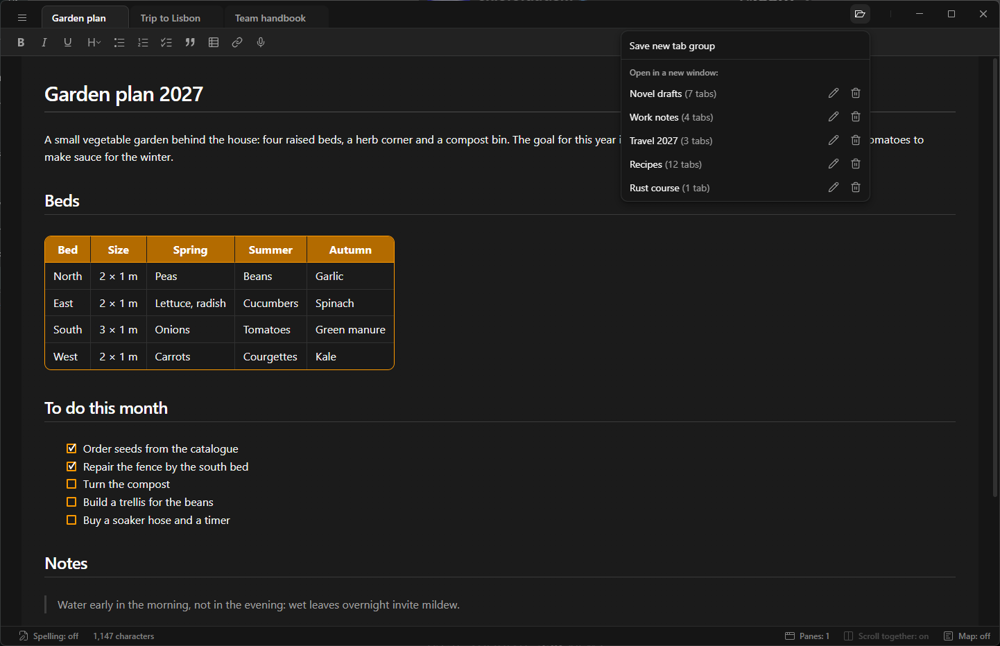

# MDE: Mark's "Dawn" Editor

A fast, lightweight editor for text documents and Markdown files on Windows 11. Portable: a single `MDE.exe`, shipped in a ZIP, no installer.

The specification lives in [docs/SPEC.md](docs/SPEC.md) and the visual design in [docs/DESIGN.md](docs/DESIGN.md).

Free and open source under the [GNU GPL v3](LICENSE).

## Screenshots



The one-pane mode: the Markdown is rendered as you edit it, with the table, the task list and the headings shown as they will look, and the syntax hidden.



The two-pane mode: the Markdown source on the left and the rendered preview on the right, scrolling together.



The minimap: a small picture of the whole document in the top right corner of the editor, with the visible part highlighted; drag it to scroll.



Tab groups: saved sets of tabs, each opening in a window of its own, which you can rename or delete right in the list.

The documents in the screenshots are in [docs/samples](docs/samples).

# Download and installation

**[Download MDE.zip](https://github.com/Mrk-Mzj/MDE-Marks-Dawn-Editor/releases/latest/download/MDE.zip)** — the latest version (`MDE.exe` and the license in `LICENSE.txt`). Older versions and the release notes are on the [Releases](https://github.com/Mrk-Mzj/MDE-Marks-Dawn-Editor/releases) page.

There is nothing to install: unpack the ZIP (right-click › *Extract All…*) and put `MDE.exe` anywhere (e.g. a `Programs` folder in your user folder, or a USB stick) and run it. No administrator rights are needed. To open Markdown files with a double click, right-click a `.md` file in Explorer, choose *Open with › Choose another app*, then *Choose an app on your PC* and point to `MDE.exe` (MDE is portable, so it does not register itself).

To uninstall, delete `MDE.exe`, and, if you want to remove your session and settings too, the folders `%APPDATA%\MDE` and `%LOCALAPPDATA%\com.marksdawn.mde`.

## Requirements

- Windows 11, 64-bit (x64; ARM PCs run it through Windows' built-in emulation). Windows 10 with the WebView2 runtime should work too, but it is not tested.
- The Microsoft Edge WebView2 runtime, which comes with Windows 11. If it is missing, MDE says so and offers to open Microsoft's download page.
- Spell checking uses the dictionaries of the languages installed in Windows (*Settings › Time & language › Language & region*). Without a Polish or English language there, MDE works normally but shows *no dictionary* for that language.

## The Windows security warning

The first time you download the ZIP and run `MDE.exe`, Windows (and your browser) may warn you that the file may be unsafe. This is expected.

**Why:** Windows trusts a program when its file is digitally signed with a code signing certificate, which costs a few hundred dollars a year, and when many people have already downloaded it. MDE is a free hobby project without such a certificate and with few downloads, so Microsoft Defender SmartScreen cannot tell who made it and treats it as unknown. The warning does not mean that anything harmful was found in the file. The whole source code is in this repository, so anyone can check what the program does or build `MDE.exe` themselves (see [Building](#building)). Download it only from the [Releases](https://github.com/Mrk-Mzj/MDE-Marks-Dawn-Editor/releases) page of this repository.

**How to run it anyway:**

1. **In the browser** (Microsoft Edge): if the download shows *MDE.zip isn't commonly downloaded*, point to it in the downloads list, click **⋯ › Keep**, then **Show more › Keep anyway**. Other browsers may ask a similar question; choose to keep the file.
2. **In Windows:** when you start the file, a blue window says *Windows protected your PC*. Click **More info**; the publisher shows as *Unknown publisher*. Click **Run anyway**.

Windows remembers the choice, so the warning does not come back for this file. After downloading a new version you may see it again.

If there is no *Run anyway* button (some company or school PCs block unknown programs), right-click `MDE.zip` (before unpacking) or `MDE.exe` in Explorer, choose *Properties*, tick **Unblock** at the bottom of the *General* tab and click *OK*. If that option is missing too, your administrator does not allow such programs.

# Status: 1.1.1

Versions are numbered x.y.z (major.minor.patch); the number lives in `package.json`, `src-tauri/Cargo.toml` and `src-tauri/tauri.conf.json` (the About dialog reads it from there).

MVP plus tabs, a single instance, session memory, spell checking, the HTML whitelist, clickable links, the formatting toolbar, the minimap, the one-pane mode (the text formatted while editing) and tab groups (1.1.0).

## Features

- **One pane or two** (*Panes: 1 / 2*, the first of the right-aligned status bar buttons, before *Scroll together*, with an application-window icon): a click switches the mode. One pane is the default at the first start; the choice is a setting of the window, the same for every tab in it (each tab group keeps its own), remembered in the session (`panes` in `session.json`). Switching keeps the place in the document, the cursor and the selection.
  - **Two panes**: the Markdown source editor on the left and the rendered GitHub Flavored Markdown preview on the right (described below).
  - **One pane** (`src/live.ts`): the editor takes the whole width and shows the text formatted, like Notepad does with Markdown, while it stays editable. The Markdown markers (`#`, `**`, `_`, `` ` ``, `~~`, `>`, `[`…`](address)`, `<u>` and the other whitelisted tags, escaping backslashes) are always hidden, also on the line with the cursor; bullets show as •, ◦, ▪ by nesting level, numbered items show their rendered number, task items an amber check box (with a white tick in it when done; clicking the box checks or unchecks the task, `[ ]` ⇄ `[x]` in the file), entities (`&amp;`) the character. The file is still the source of truth: the markers are only hidden, so saving gives the same bytes as in the two-pane mode, and undo, spell checking, Alt+↑/↓ and zoom work as before. The character count still counts the whole file with its Markdown.
  - Formatting: the toolbar, the shortcuts, or Markdown typed by hand, which turns into formatting at once (`# ` … `##### ` at the start of a line, `- `, `* `, `1. `, `> `, `**text**`, `*text*`, `_text_`). Ctrl+Z right after that keeps the typed characters as plain text (the markers get escaping backslashes, which are hidden too); the next Ctrl+Z undoes the typing.
  - Enter in a list item starts the next item (a numbered list counts on, a task item gets a new empty check box); Enter in an empty item ends the list. The same in a quote. Backspace at the start of a heading, list item or quote removes that line's format (the innermost one first); the next Backspace joins the line with the one above. Delete at the end of a line joins the next line without its block markers.
  - The cursor skips the hidden markers: one press of ← / → is one visible character. Backspace and Delete never remove a marker alone; deleting all of a formatted stretch removes its markers too, and deleting or typing over part of it keeps it formatted (`**bo|ld** te|xt` → `**bo**xt`). A cursor never lands in front of a line's hidden `# `, `> ` or `- `, so typing cannot break them.
  - Links are underlined like in the preview. A click only places the cursor; Ctrl+click opens the link (the same rules as in the preview), and the pointer becomes a hand while Ctrl is held. Hovering shows the full address and *Ctrl+click to open*. The link button (Ctrl+K) opens a field below it with the address of the link at the cursor: Enter sets it, an empty address removes the link and keeps its text, Esc cancels. Without a link at the cursor the selected text becomes a link, or the typed address is inserted as a link.
  - Tables, code blocks, raw HTML blocks (`<details>`, …), horizontal rules and images (a frame with the alt text) are rendered like in the preview. Clicking one, or moving the cursor into it, shows its Markdown source (in the code font, on the `card` background) for editing; when the cursor leaves it, it is rendered again. Ctrl+click on a link in a rendered table opens it.
  - Find (Ctrl+F) searches the visible text only: hidden markers and link addresses are skipped, and a match may run across hidden markers (`z link` finds *z linkiem* in `z [linkiem](…)`).
  - *Scroll together* is dimmed and does nothing (its tooltip says it works with two panes); it keeps its setting for the two-pane mode. The preview is not rendered while it is hidden.
- **Two panels**: Markdown source editor on the left, rendered GitHub Flavored Markdown preview on the right. Long lines always wrap; there are no horizontal scroll bars.
- **Resizable panels**: drag the line between the panels to the left or right to give one panel more width at the expense of the other (the pointer turns into a left-right arrow over the line; the line itself keeps its color, so it does not distract). Neither panel gets narrower than 200px. Double-click the line to go back to the even 50/50 split. The split is a setting of the window, the same for every tab in it (each tab group keeps its own), kept when the window is resized and remembered in the session (`split` in `session.json`, the editor panel's share of the width).
- **Synchronized scrolling** (an MDE extension; on by default): scrolling either panel (mouse wheel, keyboard, scroll bar, the cursor moving while typing) scrolls the other to the same place of the text. The status bar shows *Scroll together: on* (between *Panes* and *Map*) with a two-panel icon (a rectangle split by a vertical line); clicking it switches to *off*, and the panels then scroll independently. It is a setting of the window, the same for every tab in it (each tab group keeps its own), and it is remembered in the session (`syncScroll` in `session.json`).
  - Places are matched by source line: every block in the preview (heading, paragraph, list item, table row, code block, …) knows the lines it comes from, and positions in between are interpolated, so headings line up even where one panel is much taller (tables, code blocks, extra blank lines).
  - The matched point moves with the scroll position, from the top edge of the panels at the start to the bottom edge at the end, so with no difference between them both panels reach the start and the end of the document together.
  - Turning it on links the panels where they are, without lining them up: if the editor shows line 200 and the preview line 400, after a few pages they show 205 and 405. This lets you match the panels by hand where a part of the document is much taller in one of them. To line them up again, turn it off, scroll one panel to the place of the other and turn it back on. Each tab keeps its own difference (taken anew from its scroll positions when you switch to it).
  - When one panel reaches the start or the end of the document first, only the other one keeps scrolling, whichever panel the mouse wheel is turned over. Once both panels are at the start, or both at the end, the difference is reset, so scrolling back moves both together. Scrolling the stopped panel back before that moves both from where they are, with the difference they have at that moment, so nothing jumps.
  - Zooming, resizing the window and re-rendering after an edit keep the difference.
- **Character count**: the status bar shows, on the left right after *Spelling*, the length of the text in the active tab, *12 345 characters*, and while text is selected also the selected part, *56 of 12 345 characters*. Spaces and tabs count, line breaks do not, and an emoji or another character outside the Basic Multilingual Plane counts once. Numbers use the digit grouping of the interface language (Polish groups from five digits up: 1234, 12 345) and Polish nouns follow the Polish plural rules. The count is updated at most once per frame.
- **Document map** (minimap; off by default): a small picture of the whole document in the top right corner of the editor panel. The status bar button at the right end, after *Scroll together*, with an icon of a page with three evenly spaced lines of text, turns it *on* and *off*. It is a setting of the window, the same for every tab in it (each tab group keeps its own), remembered in the session (`minimap` in `session.json`).
  - The box (77px wide) sits in the top right corner of the editor, against the toolbar (or the find bar) and the preview panel. It is at least 100px high and grows with the file, at most down to the bottom of the panel; when the picture is taller still, it scrolls along with the editor so both reach the start and the end together.
  - The minimap takes the place of the editor's scroll bar, which is hidden while the minimap is shown and comes back when it is turned off.
  - Every word is a thin bar where the editor shows it: the text width is scaled to the width of the box and each row of text (also every wrapped row of a long line) is 2px high (a 1px bar and a 1px gap). Lines of H1 and H2 headings (`# ` / `## ` and `===` / `---` underlined, not in code blocks) are drawn lighter (`#ababab`, `#949494`), so the sections stand out. The minimap wraps the lines itself, measuring words in the editor's font at the editor's text width, so the picture is right also for parts of the file the editor has not displayed yet. Only the rows inside the box are drawn, and the row count of each line is cached by its text, so long files stay fast.
  - The part of the text on screen is a slightly lighter slider. Dragging it scrolls the editor (the slider stays under the pointer); clicking elsewhere in the box centres the slider there and can be followed by a drag. The mouse wheel over the box scrolls the editor. The minimap never takes the focus from the editor.
  - While the minimap is shown, the editor text has a fixed right margin over the whole height of the panel, wide enough that the box never covers text; turning the minimap off gives the text the full width again. The text rewraps and both panels keep showing the same place.
- **Live preview**: headings, emphasis, strikethrough, lists, task lists (an amber box in place of the bullet, with a white tick in it for `[x]`), block quotes, code, tables, links and autolinks. MDE extensions beyond GFM (see docs/SPEC.md):
  - every Enter in the file is a line break in the preview, as in the editor;
  - the space between blocks comes only from the blank lines in the file, exactly as in the editor and the one-pane mode: every blank line is an empty line of text, and blocks with no blank line between them touch (a heading with a list right below it, a paragraph followed by a quote). This holds for every kind of block — headings, paragraphs, lists and their items, quotes, tables, code blocks, horizontal rules, HTML blocks — at the top level and inside quotes and list items, also for blank lines at the start of the document; blank lines inside code blocks stay part of the code. Blocks have no margins of their own (headings, tables and code blocks keep the same small space they have in the one-pane mode, and margins never collapse), so a block sits at the same height in the preview as in the one-pane mode. The file itself is never changed.
- **Raw HTML** in a file is cleaned with a whitelist (never executed): `<br>`, `<span>` (only `color` and `background-color`, as plain colors: names, `#hex`, `rgb()`/`hsl()`), `<details>` (with `open`) and `<summary>`, `<sub>`, `<sup>`, `<kbd>` and `<u>` are shown; their other attributes are dropped. `<script>`, `<iframe>`, `<object>`, `<style>`, `<form>` (and a few similar tags) are removed with their content, `on*` attributes never survive, and any other tag is dropped while its text stays. HTML comments disappear. The file itself is never changed.
- **Links** in the preview are clickable (a left click; text selected by dragging is not a click). Hovering shows the full target.
  - `http`, `https` and `mailto` open in the default browser or mail program.
  - Web addresses may skip the scheme when they start with `www.`: both `[wp](www.wp.pl)` and plain text `www.wp.pl` become links to `https://www.wp.pl` (hovering shows the full address). Other addresses need `http://` or `https://`, because `notes.md` or `wp.pl` could just as well be file names (`.md` is also a domain).
  - A relative link to a Markdown file (`.md`, `.markdown`, `.mdown`, `.mkd`) opens it in a new tab (or switches to its tab). Relative paths are counted from the folder of the file; `%20` and the like are decoded; `?query` and `#fragment` are ignored. A file that was never saved has no folder, so such links ask you to save it first.
  - A relative link to any other file opens it in its default Windows program. The first time for each file type MDE asks, with the choice *Open and don't ask for .xxx files* (remembered in the session). Programs, scripts and other risky types (`.exe`, `.bat`, `.cmd`, `.ps1`, `.vbs`, `.msi`, `.lnk`, `.chm`, `.hta`, disk images, …, plus every type Windows itself flags as unsafe via `AssocIsDangerous`), folders and files without an extension are asked about every time.
  - Blocked, shown as plain text: `javascript:`, `data:`, `file:` and any other scheme, drive paths (`C:\…`), rooted and network paths (`/x`, `\\server\x`). Links to `#headings` are inactive.
- **Formatting toolbar** above the editor; its first icon lines up with the left edge of the text in the two-pane mode (in the one-pane mode the text has 33px of padding, 8px more, and the toolbar stays put). Buttons, with no separators: Bold, Italic, Underline, Paragraph style, Bulleted list, Numbered list, Task list, Quote, Table, Link, Dictation. Every action is one undo step and works on the selection (or the line with the cursor):
  - **Bold**, *Italic*, Underline (Ctrl+B / Ctrl+I / Ctrl+U) work like in Word. Formatting is recognized from the Markdown syntax tree (`**…**`/`__…__`, `*…*`/`_…_`, `<u>…</u>`), so markers in inline code, escaped `\*` and `snake_case` words never count:
    - the button shows as pressed when all of the selected text (or the text around the cursor) has the style;
    - clicking it then removes the style even when the markers do not touch the selection: in `**<u>WORD</u>**` with *WORD* selected, Bold leaves `<u>WORD</u>`. Removing it from part of a stretch splits it: *ma* in `**Ala ma kota**` gives `**Ala** ma **kota**`;
    - text that is only partly formatted is formatted as a whole and the markers are merged: `**Ala** ma kota` gives `**Ala ma kota**`;
    - without a selection the cursor acts like a selection of the word it is in: a click inside formatted text removes that formatting, and a click in the middle of an unformatted word formats the whole word (the cursor stays where it was). Next to a space or at the start or end of a line an empty pair of markers is inserted with the cursor inside (clicking again removes it); nothing is inserted right next to other markers or inside code, addresses and HTML tags;
    - a selection over several lines is formatted line by line; spaces at its edges and block markers (`- `, `## `, `> `) stay outside the markers. Formatting spanning several lines of one paragraph is recognized.
  - **Paragraph style** menu: *Heading 1–5* (Ctrl+1 … Ctrl+5) and *Paragraph text*. The current style is checked. Choosing the current heading level again turns the line back into paragraph text; a list item made a heading loses its list marker.
  - **Bulleted list** (`- `), **Numbered list** (`1. `, `2. `, …; numbering continues a numbered list right above), **Task list** (`- [ ] `) and **Quote** (`> `) toggle on all selected lines (one list kind turns into another); the buttons show as pressed when the line with the cursor already has that format. Empty lines are left alone (inside a quote they get `>` so the quote stays one block).
  - **Link** (Ctrl+K): the selection becomes `[text](url)` with `url` selected for typing; a selected web address goes into the parentheses and the link text is selected instead. In the one-pane mode it opens the address field described above.
  - **Table**: a grid (up to 8 × 8, mouse or arrow keys + Enter) picks the number of columns and rows (the header row included). The table is inserted below the line with the cursor, separated by empty lines, with the first header cell selected.
  - When the panel is too narrow, the buttons that do not fit move to a *More* (…) menu at the end of the toolbar.
  - **Dictation** (microphone icon, the last button, after Link; tooltip *Dictation (Win+H)*): starts Windows voice typing for the editor, like the *Dictation* item of the right-click menu. MDE presses Win+H for you (`start_dictation` in `src-tauri/src/main.rs`), so the spoken text lands where the cursor is, and the focus stays in the editor. Like the other buttons it moves to the *More* menu when the panel is narrow.
- **Find** (Ctrl+F, or *Find…* in the menu): a bar between the toolbar and the editor searches the left panel only; there is no replace. Selected text (one line) becomes the query. Matching ignores letter case unless *Match case* (the **Aa** toggle next to the field) is on, and starts at the cursor, so the match follows the query while typing.
  - All matches in the editor get a gray background and the current one (also selected) an orange one, like *Find all* in browsers. The bar counts them: *Found: 3 of 12*, *Found: 12 results* when the cursor is not on a match, *No results*.
  - Enter / Shift+Enter in the field, F3 / Shift+F3 anywhere and the ↑ / ↓ buttons at the right edge of the bar go to the next / previous match, wrapping around the document. F3 with the bar closed opens it with the last query.
  - Esc (in the field or the editor), Ctrl+F pressed again or × closes the bar and returns to the editor with the match selected. The bar stays open across tab switches, and the count follows edits.
  - Formatting shortcuts (Ctrl+B, Ctrl+1 …) do nothing while the find field has the focus.
- **Moving lines** (Alt+↑ / Alt+↓): moves the line with the cursor (or the selected lines) one line up or down. An empty line is passed in one step, and a line it touches is swapped with it, so a line travels through empty lines one at a time and then past the text. A list item moves together with its sub-items, only among the items of the same level (at the edge of the list nothing happens). The cursor or selection travels with the text and one undo step undoes the move.
- **Right-click menu**: the webview's own menu cut down to *Select all*, *Copy*, *Cut*, *Paste*, *Emoji* and *Dictation*, in that order with separators after *Select all*, *Paste* and *Emoji* (*Undo*, *Paste as plain text*, *Writing direction*, *More tools* and the rest are removed). The items stay the native ones, so Emoji and Dictation work as usual; the list is set in `src-tauri/src/context_menu.rs`.
- **Zoom**: Ctrl+plus / Ctrl+minus (also the numeric keypad) or Ctrl + mouse wheel (over any part of the window, also the tab strip) scale the text of both panels and Ctrl+0 returns to 100%. The levels are 50, 60, 70, 80, 90, 100, 110, 125, 150, 175, 200, 250 and 300%. One wheel notch is one level; touchpads add up small movements. Zoom is a setting of the window: it applies to every tab in it and to files opened there later, and it is remembered (for each tab group separately) in the session (`zoom` in `session.json`). Each panel keeps showing the same place of the text while zooming. The toolbar, tabs, menus and status bar keep their size.
- **Top bar**: hamburger menu, the tab strip and the window buttons. The top bar always stays visible; only the panels scroll.
  - The window has no system title bar; the top bar replaces it. Its empty parts (also the free part of the tab strip) move the window, and a double click there maximizes or restores it. The window keeps the Windows 11 shadow, rounded corners and resizable edges.
  - Minimize, Maximize / Restore Down and Close sit at the right end, Windows-style (46px wide, Windows 11 icons, red Close on hover, dark tooltips). Close works like the window's X used to: no questions, unsaved edits stay in the session.
  - These buttons are native (GDI, `src-tauri/src/caption.rs`), not part of the page: WebView2 repaints the page a few frames after the window changes size, so buttons in the page trailed the right edge while resizing. The native ones move with the edge. The page reserves their space at the end of the top bar. They live in a layered child window, so the page's GPU layer cannot cover them; Windows allows that only to apps that declare Windows 10 compatibility in their manifest (`src-tauri/windows-app-manifest.xml`).
- **Tabs** (*karty* in the Polish interface and docs; *zakładka* is not used for them, as it means a bookmark in the text): every open file has a tab with its name (without extension); a dot marks unsaved changes. While the pointer is over a tab, a close button (×) takes the dot's place. A tab closes with the middle mouse button, the × button or Ctrl+W.
  - New and opened files get a new tab on the right. Opening a file that is already open switches to its tab. A lone, empty *Untitled* tab is replaced by the opened file.
  - Tabs can be reordered by dragging. The mouse wheel over the tab strip switches to the previous/next tab (stopping at the first and the last one).
  - When there are too many tabs, they shrink to a minimum width; beyond that the strip shifts so the active tab is always visible.
  - Each tab keeps its own undo history, selection and scroll positions (editor and preview; with synchronized scrolling on, the preview follows the editor).
  - Closing the last tab leaves a new empty *Untitled* tab.
- **Tab groups** (like the workspaces of Edge; `src/groups.ts`, `src-tauri/src/groups.rs`): a saved set of tabs with the settings of its window, opened in a window of its own. The button at the right end of the top bar (a folder with a card, set apart from the window buttons by a thin vertical line, with the same spacing as between their icons) opens the list:
  - *Save new tab group* turns the tabs of this window into a new group and the window works on it from then on. The name is typed in place, in the list, with *Cancel* and *Save* (Enter / Esc); it cannot be empty or the name of another group (letter case aside). If it was the default window, its session is emptied, so the next start from Windows shows one *Untitled* tab with the previous settings; a group the window worked on before keeps its tabs as they are.
  - Under *Open in a new window:* the list shows the groups newest first, each with its number of tabs (*Campaign (5 tabs)*), a pencil (rename in place) and a bin. The group of this window has a lighter background and *– open* after the count (*Campaign (5 tabs) – open*). A long list scrolls.
  - Clicking a group opens it in a new window, or brings its window to the front when it is open already.
  - The bin asks *Delete?* (*Cancel* / *Delete*), or *Delete the group and close its window?* (*Cancel* / *Delete and close*) when the group is open; that window then asks about unsaved changes like closing a tab would, and *Cancel* there keeps the group. Files on disk are never touched.
  - The window title (taskbar, Alt+Tab) is *file – MDE* in every window, without the group. The default window (the one MDE opens when started from Windows) is not on the list.
  - Each window stores its own session, also on Ctrl+Q / close: tabs, unsaved edits, scroll positions, window size and place, zoom, panel split, minimap, panes, scrolling together, spelling and the file types opened from links without asking. The same file may be open in two windows; each has its own copy, and a save in one is picked up by the other when it gets the focus back (like a change by another program).
- **Commands** (menu and shortcuts):

  | Command | Shortcut |
  |---|---|
  | New file | Ctrl+N |
  | Open… | Ctrl+O |
  | Save | Ctrl+S |
  | Save as… | Ctrl+Shift+S |
  | Find / next / previous match | Ctrl+F / F3 / Shift+F3 |
  | Close tab | Ctrl+W |
  | Next / previous tab | Ctrl+Tab / Ctrl+Shift+Tab, Ctrl+PgDn / Ctrl+PgUp |
  | Exit | Ctrl+Q |
  | Bold / italic / underline | Ctrl+B / Ctrl+I / Ctrl+U |
  | Heading 1–5 | Ctrl+1 … Ctrl+5 |
  | Link | Ctrl+K |
  | Open a link (one pane) | Ctrl+click |
  | Zoom in / out / 100% | Ctrl+plus / Ctrl+minus / Ctrl+0 (or Ctrl + mouse wheel) |

- **About** (the hamburger menu, between *Find…* and *Close tab*, set apart by separators): a dark in-app dialog with the app icon, the full name, the version (read from `tauri.conf.json`), a one-line description, the copyright, the GPL v3 notice (free software, no warranty) and two links that open in the default browser: the project page on GitHub and the license text on gnu.org. OK, Esc or a click outside the dialog closes it and the focus goes back to the editor; the app's shortcuts do nothing while it is open (`src/about.ts`).
- **Save as** offers the file types *Markdown files* (selected by default, `.md`), *Text files* (`.txt`) and *All files*. Picking *Text files* changes the extension of the suggested name to `.txt`; the content is written the same way in both cases.
- **Dialogs** (`src/dialog.ts`): questions and messages (unsaved changes, opening a linked file, saving in UTF-8, a missing spelling dictionary, errors) appear inside the window in the app's dark style, not as light Windows message boxes. The window behind is dimmed; *Cancel* is the leftmost button and the main action the rightmost, filled one, which has the focus (e.g. *Cancel* | *Don't save* | *Save*); Esc answers *Cancel*, while a click outside does nothing, so a question is never dismissed by accident. A dialog asked for while another is open waits for it, and the app's shortcuts do nothing while one is open. Line breaks in the text are kept and long paths wrap.
- **Opening files**: Open dialog (several files can be selected), dragging files from Explorer onto the window (each file gets its own tab), or the command line (`MDE.exe file.md`), which makes Explorer's *Open with* work.
- **Single instance**: MDE runs as one process with one or more windows (the default window and the windows of tab groups). Starting `MDE.exe` again (also with a file) goes to the default window: it is brought to the front, or opened with its session when it is closed, and the file opens there in a new tab (or switches to its tab if it is already open there).
- **Unsaved changes**: closing a tab with unsaved changes asks whether to save, discard or cancel. Exit (Ctrl+Q or the window's close button) closes only that window and does not ask: unsaved edits stay in its session. MDE ends with its last window.
- **Session memory**: the next start restores the open tabs in their order, the active tab, unsaved edits, the scroll positions of both panels, the cursor/selection, and the window's size, position and maximized state (a position on a monitor that is no longer connected is ignored). The session is stored a second after each change and on exit, so a crash loses at most about a second of work.
  - Stored in `%APPDATA%\MDE\`: `session.json` (tabs), `window.json` (window) and `tabs\<id>.txt` (the current text of each open tab) of the default window; `groups.json` (the list of tab groups) and the same three files of each group in `groups\<id>\`. A tab's text is deleted as soon as the tab is closed; leftovers (e.g. after a crash) are removed at the next start.
  - Files are read again from disk at start-up. A tab whose file no longer exists is restored from its stored text and marked with the unsaved-changes dot; Save then asks where to save it (*Save as*).
- **Changes made by other programs** are checked at start-up and whenever the MDE window gets the focus back:
  - a tab without unsaved changes silently reloads the file;
  - a tab with unsaved changes keeps them and shows a bar *“changed by another program”* with a **Refresh** button (load the version from disk, dropping the edits) and a close button × (keep the edits and ignore that version; saving overwrites it);
  - a file deleted while open: the tab keeps its text and gets the unsaved-changes dot.
- **Byte-faithful saving**:
  - Encodings: UTF-8 with or without BOM, UTF-16 LE/BE (recognized by their BOM) and Windows-1250. A file is saved in the encoding it was read in, with the same BOM or none. New files use UTF-8 without BOM and LF.
  - Files without a BOM are read as strict UTF-8; if that fails they are read as Windows-1250 and a warning bar is shown above the panels. Every Windows-1250 byte maps to a character, so no byte is ever replaced or lost.
  - If an edited Windows-1250 file contains characters that encoding cannot store (e.g. emoji), saving asks whether to save it in UTF-8 instead; nothing is replaced silently. Cancelling leaves the file on disk untouched.
  - Line endings: LF, CRLF and lone CR are recognized. The file's dominant style is used for new lines (Enter, pasted text). In files with mixed line endings every other line break is remembered and follows its line through edits, so untouched lines keep their original ending; a line break that is deleted and retyped (or restored with undo) gets the dominant style.
  - A trailing newline (or its absence) and trailing spaces are kept.
  - A file opened and saved without edits is byte-identical (UTF-8 with/without BOM, UTF-16, Windows-1250, LF, CRLF, mixed).
  - UTF-16 files with invalid data are refused with a message.
- **Safety**: raw HTML is reduced to the whitelist above and never executed; only `http`, `https`, `mailto` and relative links are made into links; images are not loaded (a frame with the alt text is shown instead); the webview runs under a strict Content Security Policy and cannot navigate away from the app. How the sanitizer works: every tag written in the file is renamed (`<u>` → `<raw-u>`) before the page is built, and the result is rebuilt element by element, so only whitelisted elements with whitelisted attributes are ever created from the user's HTML. Colors are applied through the style object because the Content Security Policy forbids `style` attributes.
- **Spell checking** in the editor, using the Windows Spell Checking API (no dictionaries are bundled; they come from the languages installed in Windows):
  - misspelled words get a thin orange underline; only the visible part of the text is checked, so large files stay fast. After an edit the underlines are updated when typing pauses (about half a second), so a word still being typed is not flagged;
  - the status bar at the bottom shows the mode at its left end, before the character count, with a page-and-pencil icon (*Spelling: Polish*); the icon starts on the same vertical line as the B of the toolbar. Clicking it cycles Polish → English → off. The first mode is the language of Windows (Polish or English); the choice is remembered in the session;
  - if Windows has no dictionary for the chosen language, the status says so (*no dictionary*) and nothing is underlined. Clicking the status then opens a dialog explaining it, with *Open language settings* (opens Windows *Settings › Time & language › Language & region*), *Change spelling language* (the usual cycle) and *Cancel*;
  - not checked: inline code, fenced code blocks, links and addresses, HTML tags, words with digits or underscores, ALL-CAPS acronyms and CamelCase words (e.g. HTML, GitHub), single letters.
- **Interface language**: Polish on Polish Windows, English otherwise. The backend reads the Windows display language once and passes it to the page (`window.__MDE_LANG__`), so the page, the native window-button tooltips and the start-up dialog always agree. Every string lives in `src/i18n.ts` (typed, so a missing translation fails the build) or, for native parts, in `src-tauri/src/caption.rs` and `runtime_check.rs`. The webview's own right-click menu is translated by WebView2.

### Known deviations from the spec in this version

- **Changing the encoding** in the *Save as* dialog (UTF-8 / UTF-8 with BOM) is not available yet; a Windows-1250 file is converted to UTF-8 only when it contains characters Windows-1250 cannot store.
- **Text width and the page**: the text of a document is at most 1314px wide at 100% zoom (`--content-max-width`, 82.125em of the text size, so it scales with the zoom and a line keeps the same words). It sits on a page (`--background`) with padding on each side: 33px in the one-pane mode (`--page-padding-x`, 1380px in all) and 25px with two panes (`--content-padding-x`, so the text stays in line with the toolbar's B; 1364px in all). In a wider panel the page is centred and both sides get a darker backdrop (`--backdrop`, `#151515`), like the window behind a sheet of paper — 270px each in the one-pane mode on a 1920px wide screen; its width follows the window and can be 0. This holds in the editor, the one-pane mode and the preview. In the editor the page is centred on the panel's whole width, scroll bar included, so turning the minimap on or off (the scroll bar takes its place) does not move the text. The minimap then sits on the backdrop on the right; when the backdrop is too narrow for it, the text moves away from it only by the missing part, keeping its usual padding from it.
- **Colours**: dark only, built from the tokens in `src/styles.css` (docs/DESIGN.md). Besides the shadcn/ui tokens MDE has its own surfaces: the top bar and the status bar `#151515` (status bar icons and labels `#808080`), inactive tabs `#1b1b1b`, the active tab, the toolbar and the find bar `#222222`, the minimap slider (drawn under the word bars) `#323232`, the panels and the minimap `#1b1b1b`, the scroll bar thumb `#313131`. Body text in the panels is `#f3f3f3`; formatted text (bold, italic, underline, headings H1–H5) and the tick of a done task are `#ffffff`. The line under H1 is `#4f4f4f`, under H2 `#3b3b3b`.
- **Sharp icons**: the menu icon and the status bar icons are drawn for 16px on a 16-unit grid, with 1px lines centred on half pixels, and they sit on whole pixels: the status bar keeps its 24px buttons on whole pixels, and each button gets a whole-pixel width (`snapStatusButtons` in `src/main.ts`), so a label of fractional width cannot move the icons to its left off the grid. Only rounded corners and diagonals are anti-aliased. The menu icon's three 1px bars have 3px gaps (12×9px). This holds at 100% Windows scaling; at other scalings CSS pixels do not match screen pixels.
- **Tables** look the same in the preview and in the one-pane mode: as wide as their content, with four rounded corners and an amber (`--warning`) frame; an amber line under the header, whose cells are separated by lines in the page background colour, on the `#b36b00` background with bold white (`#ffffff`) text.
- **Lists** look the same in the preview and in the one-pane mode: bullets (30% larger, centred on the axis of a task box), numbers and task box frames are amber (`--warning`, the spell-check colour), and a done task has a white tick in its box. The box follows the owner's design (`src/taskbox.ts`): 14 × 14px at 100% zoom (0.875em), its bottom 1px (0.0625em) below the baseline so it looks centred on the text; its frame is a CSS border of the same geometry (2px wide, outer corners 1.4px, square inner ones), so it falls on whole screen pixels at any zoom; the tick is the owner's SVG laid over the box. A list is indented by about seven spaces (`--list-indent`, 1.92em), the text of an item starts one marker column (`--list-marker`, 1.5625em) after its bullet, number or box, each nesting level moves one marker column further, and wrapped lines of an item line up with its text. Both sizes are in em, so they follow the zoom.
- **Native dialogs**: the *Open* and *Save as* file pickers and the start-up message about a missing WebView2 are Windows dialogs (light). The question about opening a linked file offers *Open and don't ask for .xxx files* as a button rather than a checkbox.
- **Start-up** takes about 0.55–0.65 s from launch to a visible window with the file loaded (target: < 0.5 s).
- WebView2 keeps its browser cache in `%LOCALAPPDATA%\com.marksdawn.mde\`; the session lives in `%APPDATA%\MDE\`.
- Changes by other programs are noticed when the MDE window gets the focus back, not instantly while it is in the foreground.
- **The minimap in the one-pane mode** draws the Markdown source lines (markers included, all at the text size), not the formatted text; the slider still follows the editor.

# Building

## Build requirements

- [Rust](https://rustup.rs/) (stable, `x86_64-pc-windows-msvc`)
- Visual Studio Build Tools with the *Desktop development with C++* workload
- [Node.js](https://nodejs.org/) LTS
- WebView2 runtime (preinstalled on Windows 11). If it is missing, MDE shows a dialog (Polish or English, by the Windows UI language) with "Install" (opens Microsoft's installer download) and "Cancel", then exits (`src-tauri/src/runtime_check.rs`).
- Fonts: Segoe UI and Cascadia Mono from Windows; fallbacks are Arial and Consolas / Courier New. The window buttons use Segoe Fluent Icons, else Segoe MDL2 Assets.

## Commands

```bash
npm install
```

Development (hot reload):

```bash
npx tauri dev
```

Release build — the single portable `MDE.exe` lands in `src-tauri/target/release/MDE.exe`:

```bash
npx tauri build
```

The other `mde.exe` files under `target/` (`release/deps/`, `debug/`) are compiler intermediates, not for distribution.

Publishing a version: built files are not kept in the repository. MDE is shared as a ZIP holding `MDE.exe` and `LICENSE.txt`; `release/` is ignored by git. Pack it after the build:

```bash
npm run release
```

It writes `release/LICENSE.txt` (`tools/license-txt.mjs`: the text of `LICENSE` with each paragraph on one line and Windows line endings, so it opens in Notepad with a double click and wraps to the window width; the words are unchanged) and packs it with `MDE.exe` into `release/MDE.zip`.

Then create a [GitHub release](https://github.com/Mrk-Mzj/MDE-Marks-Dawn-Editor/releases) with a version tag (e.g. `v1.1.1`) and attach the ZIP under the exact name `MDE.zip`, so the download link at the top of this file (`releases/latest/download/MDE.zip`) always points to the newest version. With the [GitHub CLI](https://cli.github.com/):

```bash
gh release create v1.1.1 release/MDE.zip --title "MDE 1.1.1" --notes "What changed"
```

The app icon comes from `src-tauri/icons/icon.svg`. After changing it, rebuild `icon.ico` (16–256px) and `icon.png` (512px) with `npx tauri icon src-tauri/icons/icon.svg -o <temp folder>` and copy those two files into `src-tauri/icons/`; touch `src-tauri/build.rs` before the next build, or Cargo keeps the old icon in the exe.

Rust tests (encoding and line ending round-trips: UTF-8 ± BOM, UTF-16 LE/BE, Windows-1250, LF/CRLF/CR, mixed endings after edits):

```bash
cargo test --manifest-path src-tauri/Cargo.toml
```

# Project structure

```
LICENSE               GNU General Public License v3 (full text)
docs/                 SPEC.md (the specification), DESIGN.md (the visual design),
                      screenshots/ (the README images), samples/ (their documents)
index.html            frontend entry point for Vite (built into the exe, not opened directly)
src/                  frontend (TypeScript)
  main.ts             documents (tabs), commands, shortcuts, zoom, session memory,
                      changes made by other programs
  tabs.ts             tab strip (selecting, closing, dragging, mouse wheel)
  groups.ts           the tab groups button and its list (save, rename, delete, open)
  titlebar.ts         moving the window by the top bar (the window has no system
                      title bar) and the space for the native window buttons
  editor.ts           CodeMirror 6 editor (left panel) and its theme; the editor
                      runs in a shadow root so its styles are not blocked by the CSP;
                      it also tracks line breaks that differ from the dominant style
                      and keeps the GFM syntax tree up to date (used by the toolbar)
  find.ts             find bar (Ctrl+F, F3 / Shift+F3) and the match highlighting in
                      the editor (a CodeMirror plugin); in one pane it searches the visible text
  live.ts             the one-pane mode: hidden Markdown markers, rendered blocks and
                      widgets, cursor movement, Backspace/Delete/Enter, typed formatting
  moveblock.ts        finding and swapping the line / list item to move (Alt+↑/↓)
  spell.ts            spell checking: word finding, answer cache, underlines in the
                      editor (a CodeMirror plugin)
  preview.ts          markdown-it preview (right panel), incl. the blank-lines extension,
                      link clicks and the source-line map of its blocks
  sanitize.ts         whitelist sanitizer for raw HTML
  taskbox.ts          the task-list box (CSS frame, SVG tick), shared by the preview and one pane
  links.ts            which links are followed and how (web, relative, blocked)
  format.ts           formatting commands (bold, headings, lists, quote, link, table);
                      bold/italic/underline work on the GFM syntax tree (@lezer/markdown)
  toolbar.ts          formatting toolbar, its "more" menu, the table size picker and the
                      link address field (one pane)
  zoom.ts             zoom levels and stepping (Ctrl+plus/minus/0, Ctrl+wheel)
  scrollsync.ts       synchronized scrolling of the two panels (matched by source line)
  minimap.ts          minimap of the editor panel (own word wrapping, canvas drawing,
                      dragging the slider)
  menu.ts             drop-down menus (hamburger menu, toolbar menus)
  about.ts            the About dialog (name, version, copyright, license)
  dialog.ts           in-app dialogs (questions and messages)
  platform.ts         Tauri backend, file pickers and the app's questions
  i18n.ts             UI strings (Polish, English)
  styles.css          design tokens and styles (docs/DESIGN.md)
tools/license-txt.mjs the license as LICENSE.txt for the release ZIP
src-tauri/            backend (Rust, Tauri 2)
  src/main.rs         commands: open, save, file stamps, command-line files,
                      opening links (relative path lookup, ShellExecute), starting Windows
                      voice typing (Win+H);
                      single instance; opening windows (default and tab groups)
  src/spell.rs        Windows Spell Checking API on a dedicated COM thread
  src/caption.rs      native minimize / maximize / close buttons over the top bar
  src/context_menu.rs the right-click menu (WebView2 menu trimmed and reordered)
  src/session.rs      session storage in %APPDATA%\MDE (tabs, tab texts, window), one
                      folder per window; the open windows and their groups
  src/groups.rs       tab groups: the list (groups.json), creating, renaming, deleting,
                      opening a group's window
  src/textfile.rs     byte-faithful decoding/encoding (UTF-8, UTF-16, Windows-1250,
                      per-line line endings) + tests
  windows-app-manifest.xml  exe manifest (common controls 6, Windows 10/11 compatibility)
  tauri.conf.json     app config, Content Security Policy
  capabilities/       permissions granted to the frontend
  icons/              app icon: icon.svg (source), icon.ico and icon.png (built from it)
```

# Tech stack

Tauri 2 (Rust + WebView2) with tauri-plugin-single-instance, the `windows` crate (spell checking, opening links), CodeMirror 6 (with the @lezer/markdown parser for the syntax tree), markdown-it, Vite, TypeScript.

# Contributing

This is a personal project; pull requests are not accepted, but bug reports in [Issues](https://github.com/Mrk-Mzj/MDE-Marks-Dawn-Editor/issues) are welcome.

# License

Copyright © 2026 Marek Mazij.

MDE is free software: you can redistribute it and/or modify it under the terms of the GNU General Public License version 3 (GPL-3.0-only), as published by the Free Software Foundation. The full text is in [LICENSE](LICENSE).

MDE is distributed in the hope that it will be useful, but WITHOUT ANY WARRANTY; without even the implied warranty of MERCHANTABILITY or FITNESS FOR A PARTICULAR PURPOSE. See the GNU General Public License for more details.

In short: you may use MDE for any purpose, share it and change it. If you distribute it, or a program based on its code, you must do so under the same license and make the source code available.

The libraries MDE is built with keep their own licenses, all compatible with the GPL v3: Tauri, CodeMirror, markdown-it, @lezer/markdown and the `windows` crate are under MIT or Apache-2.0.
